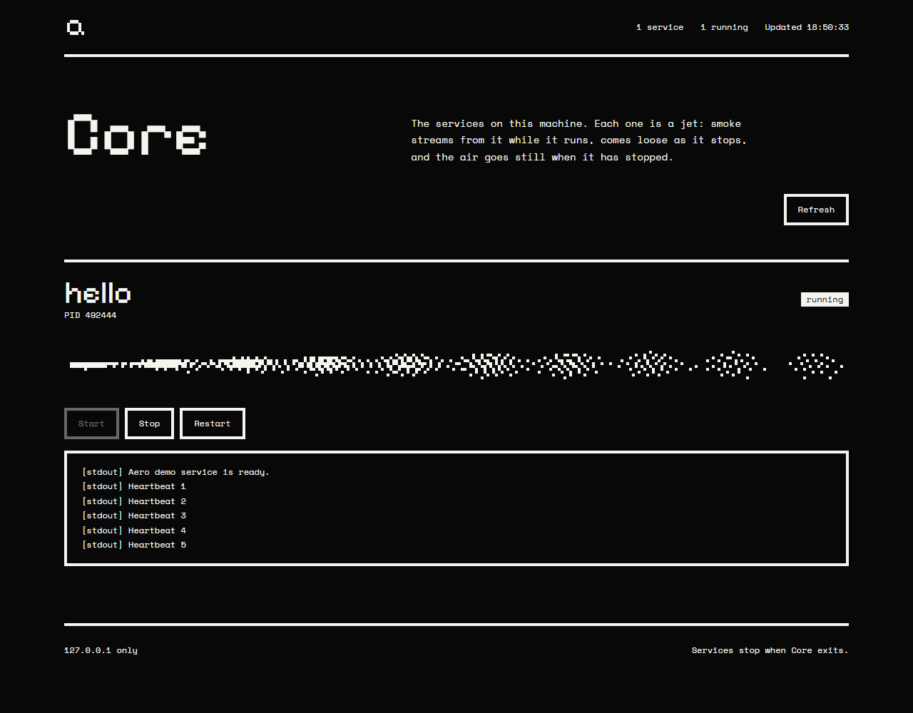

# Aero Core


Aero Core manages named applications on the machine where it runs. Its browser dashboard and local HTTP API start and stop processes through [Aero Shell](https://github.com/aero-devops/shell), show their state, and display recent output.



Each service in the dashboard is drawn as a jet: smoke streams from it while it runs, comes loose as it stops, and the air goes still once it has stopped. A failed service leaves a short puff that scatters.

## Run the demo

Requires Node.js 20 or later. Clone [core](https://github.com/aero-devops/core) and [shell](https://github.com/aero-devops/shell) beside each other, then:

```sh
cd core
npm install
npm run demo
```

Open the URL printed in the terminal. The demo service emits one log line every few seconds. Use the Start, Stop, and Restart buttons to see the control path.

For your own service, copy `examples/aero.demo.json` and change the service name, executable, arguments, and working directory. Run `node src/cli.js --config path/to/your.json --port 4173`.

The configuration file is trusted local input. It can launch any executable available to the Aero process. Never accept untrusted config files. The server listens on `127.0.0.1`, has no user authentication, and must not be exposed to the network. It is intended as a local preview of the control plane.

Processes run only while Core is running. When Core exits normally, it stops its children. It does not yet deploy code, survive restarts, manage remote hosts, or route public traffic.

## HTTP API

| Method | Path | Result |
| --- | --- | --- |
| GET | `/health` | Management server health |
| GET | `/api/apps` | Configured names and current states |
| GET | `/api/apps/:name/logs` | Recent output for one app |
| POST | `/api/apps/:name/start` | Start an app |
| POST | `/api/apps/:name/stop` | Stop an app |
| POST | `/api/apps/:name/restart` | Restart an app |

POST requests require the `X-Aero-Control: 1` header. The header is a browser request guard, not user authentication.

## Development

`npm test` runs API and configuration checks. The Shell package has its own tests. Both repositories are intentionally separate; the current dependency uses a sibling local package path until a distribution channel is chosen.

